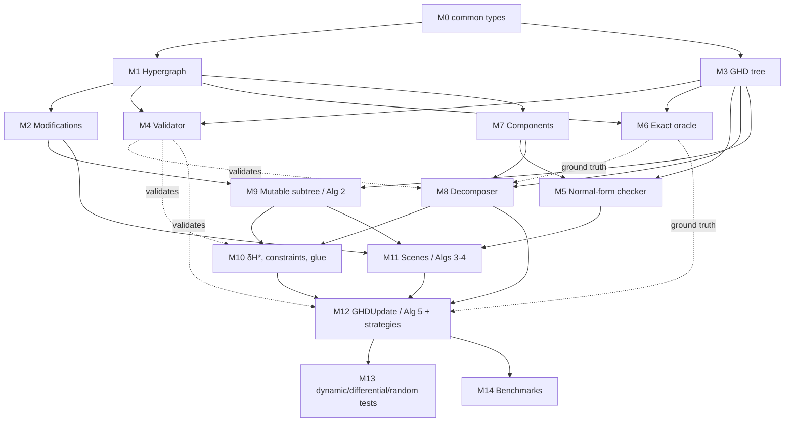

# IMPLEMENTATION_PLAN — Incremental Updates of GHDs (Phase 1 deliverable)

Status: **awaiting review.** No algorithm code has been written yet.
Companion document: `PAPER_ANALYSIS.md`. Its ambiguity IDs A1–A24 and result names are referenced throughout.

---

## A. Overall architecture

### A.1 Guiding decisions

1. **Edges have identities.** Hyperedges are named (`w1`, `w2`, …), as in the paper. Every modification returns an explicit edge map $s_\delta$ (old name → new name or `None`). Lemma 4.4 needs edge-by-edge comparison (A2), Algorithm 2 needs it, and so do scenes.
2. **Immutable hypergraphs, copy-on-write decompositions.** A `Hypergraph` is a frozen value, so $\delta(H)$ is a new object and the old $H$ stays available. A GHD is a mutable tree, but every update works on a copy.
3. **The validator and the exact-width oracle are written independently of the decomposer**, by a different agent, without reading the decomposer code. They are the ground truth for every other test.
4. **Exactness is tracked, never inferred.** Every search returns `FOUND`, `PROVEN_NO` (an exhaustive exact search failed) or `NOT_FOUND` (a heuristic or budget-limited search failed). A "no" from SearchUpdateGHD is `PROVEN_NO` only if established by an exact search of all of $\delta(H)$ at width $k$.
5. **The paper's literal pseudocode is the default.** Every ambiguity from PAPER_ANALYSIS §4 that changes behaviour gets a named switch (`Semantics` config), a pinning test, and an entry in `FAITHFULNESS_LEDGER.md`. This is the same convention as the sibling `dynamic-treewidth` project.
6. **Three update strategies share one interface**, so they can be compared directly:
   - `PaperUpdate`: Algorithms 2–5 (scenes plus decomposer). This is the faithful implementation.
   - `Theorem45Repair`: compute $\delta(H)^*$ and the $T^*$-induced constraints, decompose under the constraints, then glue. The direct constructive use of Theorem 4.5.
   - `Recompute`: the paper's *Classic* baseline, which decomposes $\delta(H)$ from scratch with the same decomposer.

### A.2 Modules

| # | Module (package) | Responsibility | Paper basis |
|---|---|---|---|
| M0 | `ighd.common` | types (`Vertex`, `EdgeName`), the `SearchStatus` and `Semantics` enums, errors, `Budget` | — |
| M1 | `ighd.hypergraph` | the `Hypergraph` value: incidence both ways, $B(E)$, adjacency, induced subhypergraphs, edge-wise and set-wise comparison, a HyperBench parser | §2.1, D2–D5 |
| M2 | `ighd.modifications` | the six classes, each producing a `ModificationResult` ($\delta(H)$, $s_\delta$, $V_{new}$, removed vertices and edges, description); composition of sequences | Defs 3.1–3.4 |
| M3 | `ighd.ghd.tree` | the rooted GHD tree: nodes, bags, covers, parent and children, traversal, subtrees, forest split, re-rooting, gluing primitive | §2.2, D6–D8 |
| M4 | `ighd.ghd.validate` | the **independent** validator for conditions (1)–(3), width, coverage maps, detailed error report | §2.2 |
| M5 | `ighd.ghd.normal_form` | the replay-based normal-form checker (and later a normaliser) | §2.3, D10 |
| M6 | `ighd.oracle` | exact ghw by elimination-order DP, exact edge-cover number, brute-force minimal δ-mutable subtree. Small instances only; independent of M7–M11 | background |
| M7 | `ighd.static.components` | [U]-components on edges (D9, A3), connection sets | §2.3 |
| M8 | `ighd.static.decomposer` | the top-down decomposer (Alg 1 completed with connection sets). EXACT and HEURISTIC separator modes; coverage-only pseudo-edges; optional scene hints; budget | §2.3, Alg 1 |
| M9 | `ighd.mutable` | the Def 4.1 condition checker and Algorithm 2 (minimal $T^*$), with a step log | Def 4.1, Lemma 4.4, Alg 2 |
| M10 | `ighd.constraints` | $\delta(H)^*$, the $T^*$-induced bag constraints, outer forest extraction, Theorem 4.5 gluing | §4.1, Lemma 4.2, Thm 4.5 |
| M11 | `ighd.scenes` | `SceneMapping` (in/out kinds, single use, keys), Algorithm 3 and Algorithm 4 with switches for A16, A17 and A23 | Def 5.1, Algs 3–4 |
| M12 | `ighd.update` | `DecompUpdate`, `GHDUpdate` (Alg 5), the DelVar fast path, the three strategies, `UpdateResult` and an `UpdateTrace` exposing every intermediate stage, and the minimality check | §3.2, §5, Alg 5 |
| M13 | `tests/…` + `ighd.testing` | paper fixtures, random generators, differential harness | — |
| M14 | `benchmarks/` | HyperBench loader, the §6.1 modification generator, runner, statistics (geometric means, Positive and Better percentages), plots | §6 |

### A.3 Repository layout (new project `dynamic_ghd/incremental-ghd/`)

```
incremental-ghd/
├── pyproject.toml            # Python ≥3.11; pytest, hypothesis (test extra); pandas/matplotlib (bench extra)
├── README.md   PROGRESS.md   FAITHFULNESS_LEDGER.md
├── docs/  PAPER_ANALYSIS.md  IMPLEMENTATION_PLAN.md  MATHEMATICAL_INVARIANTS.md  ARCHITECTURE.md  TESTING_REPORT.md
├── src/ighd/
│   ├── common/        types.py errors.py config.py
│   ├── hypergraph/    core.py induced.py compare.py io_hyperbench.py
│   ├── modifications/ base.py ops.py sequence.py
│   ├── ghd/           tree.py validation.py normal_form.py render.py
│   ├── oracle/        edge_cover.py ghw_dp.py brute_mutable.py
│   ├── static/        separation.py decomposer.py
│   ├── mutable/       conditions.py minimal.py
│   ├── constraints/   target.py constraints.py gluing.py
│   ├── scenes/        mapping.py scene_down.py scene_up.py
│   └── update/        result.py decomp_update.py pipeline.py strategies.py delvar.py
├── tests/ unit/ mathematical_properties/ paper_examples/ dynamic_updates/ differential/ randomized/ fixtures/paper.py
├── examples/   (runnable walk-throughs of Examples 2.3, 4.3, 5.2)
└── benchmarks/ generate.py run.py report.py data/ (HyperBench, downloaded on request)
```

---

## B. Dependency analysis

### B.1 Dependency graph



Implementation order (topological): **M0 → {M1, M3} → {M2, M4, M6, M7} → {M5, M8, M9} → {M10, M11} → M12 → {M13, M14}**.

The order is driven by what each layer needs: correctness ground truth (M4, M6) exists **before** anything it judges (M8 onwards), and the dynamic layer starts only once the static layer it reuses is validated.

### B.2 Module specifications

| Module | Inputs | Outputs | Data structures | Mathematical properties relied on | Depends on | Correctness tested by |
|---|---|---|---|---|---|---|
| M1 Hypergraph | edge dict `name → iterable[vertex]` | frozen `Hypergraph` | `dict[EdgeName, frozenset[V]]`, inverse incidence `dict[V, frozenset[EdgeName]]` | D2 (non-empty edges, $V = \bigcup E$), D4 (induced, A1), A2 comparisons | M0 | unit tests on $H_P$, $H_{P'}$; hypothesis: incidence round trip, $H[U][W] = H[W]$ for $W \subseteq U$ |
| M2 Modifications | `Hypergraph`, operation parameters | `ModificationResult(new, s_delta, new_vertices, removed_vertices, new_edges, removed_edges, kind, description)` | frozen dataclasses | Defs 3.1–3.4, A5–A9 | M1 | Ex. 3.5 exact reproduction; inverse pairs give the original back (up to names); invalid parameters raise |
| M3 GHD tree | nodes (bag, cover), edges, root | `GHD` | `dict[int, Node]`, parent and children lists, stable int ids | tree axioms | M0 | unit tests: subtree, forest split, ancestors, connected-subset check, glue |
| M4 Validator | `Hypergraph`, `GHD` | `ValidationReport(ok, violations[], width, cover_map)` | — | GHD conditions (1)–(3) exactly (A4) | M1, M3 | one deliberately broken GHD per condition; Fig. 3 and Fig. 6a accepted |
| M5 NF checker | `Hypergraph`, rooted `GHD` | `NFReport` (per-node component↔child matching) | — | D10 | M3, M7 | Fig. 3 and Fig. 6a are NF; crafted non-NF examples rejected |
| M6 Oracle | `Hypergraph` (≤ ~14 vertices), or a GHD + δ (≤ ~10 nodes) | exact ghw plus a witness GHD; the set of all δ-mutable subtrees | subset DP tables | ghw = min over elimination orders of max ρ(bag) [bg]; ρ monotone | M1, M3 | known values (ghw $H_P$=1, $H_{P'}$=2, $H_{P_2}$=2, $H_{P_3}$=2, cycle $C_n$=2, $K_4$ as a graph = 2); witness passes M4 |
| M7 Components | `Hypergraph`, edge subset, separator vertices $U$ | list of components (frozensets of edge names), connection set per component | union-find over edges keyed by vertices outside $U$ | D9, A3 | M1 | Ex. 2.3 / Fig. 4; Ex. 5.2; hypothesis: the components partition the edges not inside $U$, and two edges are in the same component iff an [U]-path joins them (BFS reference) |
| M8 Decomposer | $H$, target edge set, `conn`, $k$, guard pool, coverage-only edges, optional σ, mode, budget | `DecompResult(status, ghd_fragment, stats)` | memo table `(edgeset, conn) → result` | normal-form theorem [13]; components; guard from all of $E(H)$ | M3, M7 | output always passes M4; in EXACT mode, FOUND ⇔ oracle ghw ≤ k on random small instances; Ex. 2.3 replay |
| M9 Mutable | $H$, `ModificationResult`, GHD | $T^*$ plus a step log | — | Def 4.1, Lemma 4.4, A2, A12 | M2, M3 | Ex. 4.3 trace ($\{u_1,u_2\}$); guide traces; equals the brute-force minimum (M6) on random small cases |
| M10 Constraints/glue | $\delta(H)$, GHD, $T^*$, a GHD $\mathcal{D}^*$ | $\delta(H)^*$, constraints $C_i$, glued GHD | — | D19, D20, Lemma 4.2, Thm 4.5 | M8, M9 | Ex. 4.3 completion ($C_3 = \{a,h\}$, $C_4 = \{k\}$); every glued result passes M4; Lemma 4.2 property test |
| M11 Scenes | $\delta(H)$, GHD (NF), $T^*$, $s_\delta$ | `SceneMapping` plus a trace | dict `frozenset[EdgeName] → SceneEntry(node, kind, used)` | Def 5.1, Algs 3–4, A16, A17, A23 | M5, M7, M9 | Ex. 5.2 pinned under every switch; the O(N³) bound measured |
| M12 Update | $H$, minimal GHD, modification, $k$, strategy, decomposer, semantics | `UpdateResult(status, ghd, width, minimality, trace)` | `UpdateTrace` with all stages | §3.2, Alg 5, Thm 4.5, A14, A18–A21 | M8–M11 | Levels 3–6 (below) |

---

## C. Step-by-step roadmap

Every stage follows the 11-step workflow (concept → paper reference → design → signatures → code → tests → run → manual trace → invariants → docs/PROGRESS → next). "Done" means its tests pass **and** its manual trace matches.

### S0 — Skeleton, shared interfaces, paper fixtures (main agent)
1. **Objective:** freeze interfaces before any parallel work starts.
2. **Background:** D2, D6, D15, D21; the result taxonomy (A.1.4).
3. **Algorithms:** none.
4. **Functions/classes:** `Vertex`, `EdgeName`, `SearchStatus{FOUND, PROVEN_NO, NOT_FOUND}`, `UpdateStatus{UPDATED, PROVEN_NO, NOT_FOUND}`, `Semantics` (switches for A2, A3, A16, A17, A23), `Budget`, and Protocols `Decomposer` and `Modification`. Signature stubs (`...`) for every public function in M1–M12. `tests/fixtures/paper.py` with $H_P, H_{P'}, H_{P_2}, H_{P_3}$, Fig. 3 ($G'$), Fig. 6a ($G_2$), and the guide's join-tree GHD of $H_P$, all as plain data.
5. **I/O:** none at runtime.
6. **Edge cases:** none.
7. **Unit tests:** imports resolve; the fixtures are well formed (edges non-empty, names unique).
8. **Expected output:** `pytest` collects and passes the smoke tests.
9. **Dependencies:** none.
10. **Completion criteria:** interface review signed off by you, `FAITHFULNESS_LEDGER.md` seeded with A2, A3, A9, A16, A17, A21, A23.

### S1 — Hypergraph (M1)
1. **Objective:** a correct, immutable hypergraph.
2. **Background:** D2–D5, A1, A2.
3. **Algorithms:** incidence construction; induced restriction; edge-wise and set-wise equality; adjacency; HyperBench text parser (`e1(v1,v2),` format).
4. **Functions/classes:** `Hypergraph(edges)`, `.vertices`, `.edge(name)`, `.incident(v)`, `.cover_vertices(names)` (= $B(E)$), `.neighbors(v)`, `.induced(U) -> InducedView`, `compare_induced(H1, H2, U, s_delta, mode)`, `.with_edges/without_edges`, `parse_hyperbench(text)`.
5. **I/O:** dict → Hypergraph; Hypergraph × U → `dict[EdgeName, frozenset]`.
6. **Edge cases:** empty hypergraph; a singleton edge; duplicate vertex sets under different names (A9); an empty edge (rejected); a vertex not in any edge (impossible by construction); a disconnected hypergraph; $U$ containing unknown vertices (ignored, documented).
7. **Unit tests:** rank, degrees and iwidth of $H_{P'}$ (3; 2/1; 1); $H_{P'}[\{a,d,f,g,h\}]$ = {w4:{a,d,f}, w2:{f,g,h}, w1:{a}, w5:{h}}; the A2 counterexample differs edge-wise but agrees set-wise on the parts.
8. **Expected output:** as listed in 7.
9. **Dependencies:** S0.
10. **Done when:** all tests pass, plus hypothesis properties (round-trip incidence; induced composition).

### S2 — Modifications (M2)
1. **Objective:** all six classes, with full change information.
2. **Background:** Defs 3.1–3.4, A5–A9, D21.
3. **Algorithms:** apply each operation; build $s_\delta$; derive $V_{new}$ and the removed vertices; compose sequences (the composed $s_\delta$).
4. **Classes:** `AddVar(w, edges)`, `DelVar(v)`, `AddConstr(name, vertices)`, `DelConstr(name)`, `AddEq(U, into=w)`, `DelEq(w, parts: dict[new_vertex, edges])`, each with `.apply(H) -> ModificationResult`; `compose(results)`.
5. **I/O:** Hypergraph → ModificationResult.
6. **Edge cases:** AddVar with $E' = \emptyset$ (reject) or an existing $w$ (reject); DelVar emptying an edge (A6); DelConstr isolating vertices (A7); AddEq with $w \in U$ vs $w \notin U$ (A8); merged duplicates (A9); DelEq parts not covering $E_{\{w\}}$ (reject); AddConstr whose edge equals an existing vertex set (allowed, flagged).
7. **Unit tests:** Ex. 3.5: AddVar($h$ into $w_2, w_5'$) on $H_P$ = $H_{P'}$; AddConstr($w_7=\{c,i\}$) gives $H_{P_2}$; AddEq($\{b,g\}\to g$) gives $H_{P_3}$; inverses return the original; $s_\delta$ and $V_{new}$ exact.
8. **Expected output:** AddVar($h$): $V_{new}=\{h\}$, $s_\delta(w_2)=w_2$ with new contents $\{f,g,h\}$.
9. **Dependencies:** S1.
10. **Done when:** every class is tested in isolation and as part of an inverse pair.

### S3 — GHD tree (M3)
1. **Objective:** a rooted tree with bags and covers, plus the structural operations the update needs.
2. **Background:** D6–D8, D17.
3. **Algorithms:** DFS/BFS traversal, subtree extraction, forest split $T\setminus T'$, re-rooting, gluing (attach a forest by edges), copy with fresh ids.
4. **Classes:** `Node(id, bag, cover)`, `GHD(root, nodes, children, parent)`; `subtree(u)`, `descendants`, `ancestors`, `is_connected(node_set)`, `split_off(T_prime) -> list[GHD]`, `reroot(u)`, `attach(parent_id, other_ghd, at_node)`, `copy()`, `B(node_set)`, `leaves(node_set)`.
5. **I/O:** pure structure; names only (no Hypergraph needed).
6. **Edge cases:** a single node; empty node sets; splitting off the root; gluing a forest with several roots; an id collision on glue (re-id).
7. **Unit tests:** split Fig. 6a by $\{u_1,u_2\}$ → forests $\{u_3\}$, $\{u_4\}$; the leaves of a working tree; reroot preserves the edge set.
8. **Expected output:** as in 7.
9. **Dependencies:** S0.
10. **Done when:** property tests on random trees pass (split + glue = original).

### S4 — Independent validator (M4)
1. **Objective:** a decisive, informative checker for "is this a GHD of H, and what is its width".
2. **Background:** GHD conditions (1)–(3), D7; A4.
3. **Algorithms:** per-edge coverage search; per-vertex occurrence-set connectivity (BFS within the induced node set); guard containment; width.
4. **Functions:** `validate(H, ghd) -> ValidationReport` with typed violations `UncoveredEdge(e)`, `DisconnectedVertex(v, parts)`, `UnguardedVertices(u, missing)`, `UnknownEdgeInCover(u, e)`, `UnknownVertexInBag(u, v)`; `width(ghd)`; `edge_cover_map(H, ghd)`.
5. **I/O:** (H, GHD) → report.
6. **Edge cases:** a vertex in no bag; a cover edge not in $H$; empty bags (allowed, flagged as a warning); a bag vertex not in $H$.
7. **Unit tests:** Fig. 3 is valid for $H_{P'}$ with width 2; Fig. 6a is valid for $H_{P_2}$; Fig. 6a is **invalid** for $H_{P'}$ ($w_7$ guard unknown); three single-fault mutants of Fig. 3 (drop $w_6$ coverage, break connectivity of $k$, remove $w_5$ from $\lambda_{t_1}$), each producing exactly one expected violation.
8. **Expected output:** e.g. removing $w_5$ from $\lambda_{t_1}$ gives `UnguardedVertices(t1, {c,h})`.
9. **Dependencies:** S1, S3. **Written by the oracle/validator agent, not the decomposer agent.**
10. **Done when:** every violation kind is exercised, and there are zero false positives on a random-valid corpus produced from oracle witnesses.

### S5 — Exact oracle (M6)
1. **Objective:** independent ground truth for ghw and for the minimal $T^*$.
2. **Background:** [bg] ghw(H) = min over tree decompositions of max ρ(bag). The minimum is attained among elimination-ordering decompositions because ρ is monotone. Edge-cover number ρ by exact set cover.
3. **Algorithms:** (a) $\rho(B)$ by smallest-first subset search over the edges meeting $B$; (b) the subset DP $f(S) = \min_{v\in S}\max(f(S\setminus v), \rho(\{v\}\cup Q(S\setminus v, v)))$ over the primal graph, returning a witness GHD; (c) enumerate all connected subtrees of a small GHD, filter by Def 4.1, return all δ-mutable ones.
4. **Functions:** `edge_cover_number(H, B)`, `exact_ghw(H) -> (int, GHD)`, `all_mutable_subtrees(H, mod, ghd, semantics)`.
5. **I/O:** small instances only, guarded (raise if $|V| > 16$ or more than 12 nodes).
6. **Edge cases:** an empty hypergraph (ghw 0); one edge (ghw 1); disconnected hypergraphs (max over components).
7. **Unit tests:** ghw: $H_P$=1, $H_{P'}$=2, $H_{P_2}$=2, $H_{P_3}$=2, triangle graph=2, $C_5$=2, $K_5$ as a graph=3; witnesses pass M4.
8. **Expected output:** as listed.
9. **Dependencies:** S1, S3, S4 (to self-check witnesses). **Must not import M7/M8.**
10. **Done when:** values match hand-verified cases, and witness GHDs validate.

### S6 — [U]-components and connection sets (M7)
1. **Objective:** the exact paper notion (D9), edge-based.
2. **Background:** D9, A3.
3. **Algorithms:** union-find over the edges of $H'$ not contained in $U$, merging edges that share a vertex outside $U$; for each component, `conn = V(c) ∩ U`.
4. **Functions:** `components(H, edge_subset, U) -> list[frozenset[EdgeName]]`, `inside_edges(H, edge_subset, U)`, `connection(H, comp, U)`.
5. **I/O:** as stated, in deterministic order (sorted by the smallest edge name).
6. **Edge cases:** $U=\emptyset$ (ordinary connectivity of edges); $U \supseteq V$ (no components); edges sharing only $U$-vertices; a single edge.
7. **Unit tests:** $[\{c,e,h,i,k\}]$ on $H_{P'}$ gives $\{w_1,w_2,w_4\}, \{w_6\}$; $[\{a,b,c,e,h\}]$ on $H_{P'}$ gives $\{w_3,w_6\}, \{w_2,w_4\}$; $C_1$ w.r.t. $\{a,b,c,f,g,h\}$ gives $\{w_4\}$.
8. **Expected output:** as listed (Examples 2.3 and 5.2).
9. **Dependencies:** S1.
10. **Done when:** a hypothesis equivalence check against a naive BFS definition passes.

### S7 — Static decomposer (M8)
1. **Objective:** Algorithm 1 made concrete. Exact on small instances, honest heuristic otherwise; reusable by the update algorithm.
2. **Background:** Alg 1, normal form [13], A13. Exact search space (justified in PAPER_ANALYSIS §3): state $(C, conn)$ with $W = V(C)\setminus conn$. Choose a guard set $\lambda \subseteq E(H)$ with $|\lambda|\le k$ and $conn \subseteq B(\lambda)$, and a bag $B$ with $conn \subseteq B \subseteq B(\lambda) \cap (W\cup conn)$ and $B \cap W \ne \emptyset$. Recurse on the [B]-components of $C$ with $conn_i = V(C_i)\cap B$. Coverage-only edges must be covered and may not guard.
3. **Algorithms:** memoised recursive search (failures cached by $(C, conn)$, valid because the subproblem depends only on these and $k$). EXACT mode enumerates every subset $B$. HEURISTIC mode uses only $B = B(\lambda)\cap(W\cup conn)$, the det-k-decomp/HD style: sound but incomplete for ghw. Scene hints are tried first, then the full search continues (A19). Budget limits on nodes and time.
4. **Functions:** `decompose(H, k, *, edges=None, conn=frozenset(), coverage_only={}, guard_pool=None, scenes=None, mode=EXACT, budget=None) -> DecompResult`; `ghw_by_search(H, mode)` (iterate k = 1, 2, …).
5. **I/O:** an NF GHD fragment, rooted, whose root bag ⊇ conn.
6. **Edge cases:** $k=0$; an empty edge set; conn not coverable (immediate PROVEN_NO in EXACT); components smaller than or equal to k (base case); budget exhaustion gives NOT_FOUND, never PROVEN_NO.
7. **Unit tests:** Ex. 2.3: forcing the root separator $\{w_5,w_3\}$ reproduces Fig. 3 exactly; ghw by search equals the oracle on $H_P$, $H_{P'}$, $H_{P_2}$, $H_{P_3}$; every output passes M4 and M5.
8. **Expected output:** `ghw_by_search(H_{P'}) == 2`; `decompose(H_{P'}, 1)` gives PROVEN_NO (EXACT).
9. **Dependencies:** S3, S4, S6 (S5 for differential tests).
10. **Done when:** EXACT agrees with the oracle on more than 500 random small hypergraphs (fixed seeds), and HEURISTIC never returns an invalid GHD and never returns PROVEN_NO.

### S8 — Normal-form checker (M5)
1. **Objective:** enforce the precondition of Def 5.1.
2. **Background:** D10, Alg 3 replay logic.
3. **Algorithms:** top-down replay. At node $n$ with edge set $H_n$ (root: $E(H)$), compute the $[B_n]$-components, require a bijection to the children via the L16 rule, and require each component's edges to be covered in that child's subtree; recurse.
4. **Functions:** `check_normal_form(H, ghd) -> NFReport`; (deferred, R6) `normalize(H, ghd)`.
5. **I/O:** report with the first violation.
6. **Edge cases:** a leaf whose bag leaves no components; an extra child (non-NF); a component split across two children (non-NF).
7. **Unit tests:** Fig. 3 and Fig. 6a are NF; the join-tree GHD of $H_P$ rooted at $p_1$ is NF; a crafted non-NF GHD is rejected with the right reason.
8. **Expected output:** as listed.
9. **Dependencies:** S3, S6.
10. **Done when:** every decomposer output (S7) passes it.

### S9 — δ-mutable subtrees (M9)
1. **Objective:** an exact Def 4.1 checker and Algorithm 2.
2. **Background:** Def 4.1, Lemma 4.2, Lemma 4.4, A2, A10, A12.
3. **Algorithms:** `is_mutable(T*)` evaluates both conditions literally (condition (i) by `compare_induced` in EDGEWISE or SET mode; condition (ii) by the adjacency of $V_{new}$). Algorithm 2 with a deterministic leaf order and a full step log (leaf, U, A=B?, adjacent new vertices, decision).
4. **Functions:** `mutable_conditions(H, mod, ghd, T_star, semantics) -> (bool, bool, details)`, `minimal_mutable_subtree(H, mod, ghd, semantics) -> (frozenset[int], log)`.
5. **I/O:** as stated.
6. **Edge cases:** an empty $T^*$ (A12); a single-node GHD; a modification affecting every bag.
7. **Unit tests (manually verified expected outputs):** Ex. 4.3 gives $\{u_1,u_2\}$ with the exact step log of guide §6.5; AddConstr $\{c,i\}$ on $G'$ gives $\{t_1,t_2\}$; AddVar $m$ into $w_6$ gives $\{t_1,t_4\}$; AddEq $b\to g$ gives $\{t_2\}$; DelEq gives $\{s_1,s_2,s_3\}$; AddVar $h$ on the join tree gives $\{p_1..p_5\}$; and Lemma 4.2 holds for each outer tree (validated with M4 against $\delta(H)[T']$).
8. **Expected output:** as in 7.
9. **Dependencies:** S2, S3, S4, S5 (brute-force oracle).
10. **Done when:** on random small cases Algorithm 2 equals the unique brute-force minimum (EDGEWISE), and SET-mode disagreements are logged, not hidden.

### S10 — $\delta(H)^*$, bag constraints, Theorem 4.5 gluing (M10)
1. **Objective:** the constructive Theorem 4.5 path (`Theorem45Repair`).
2. **Background:** D19, D20, Lemma 4.2, Thm 4.5, A11.
3. **Algorithms:** build $\delta(H)^*$; compute one constraint per outer tree; reduce constraints to **coverage-only pseudo-edges** for the decomposer; glue each outer tree $T_i$ by the edge $u_i - u_i^*$ to a node whose bag contains $C_i$.
4. **Functions:** `redecomposition_target(H, mod, ghd, T_star) -> SubProblem`, `bag_constraints(ghd, T_star) -> list[(outer_root, C_i)]`, `glue(D_star, outer_trees, constraints) -> GHD`, `theorem45_repair(...) -> UpdateResult`.
5. **I/O:** a GHD of $\delta(H)$ or NOT_FOUND (a failure here is **not** a "no", A.1.4).
6. **Edge cases:** $T^*$ = whole tree (no constraints); $T^* = \emptyset$; one $\mathcal{D}^*$ node satisfying several constraints; a constraint equal to ∅ (an outer tree sharing no vertex: attach anywhere).
7. **Unit tests:** Ex. 4.3: $C_3=\{a,h\}$, $C_4=\{k\}$; glued result = guide §6.8 (validates, width 2). Guide §8 cases AddVar-m, AddConstr, AddEq, DelEq reproduce the documented final GHDs. A hand-made $\mathcal{D}^*$ violating a constraint makes `glue` refuse.
8. **Expected output:** as listed.
9. **Dependencies:** S7, S9.
10. **Done when:** every glue output on random cases passes M4, and the width is ≤ k.

### S11 — Scene mapping, Algorithms 3–4 (M11)
1. **Objective:** faithful scene creation, with each ambiguity switchable.
2. **Background:** Def 5.1, Algs 3–4, Prop 5.3, A16, A17, A20, A23.
3. **Algorithms:** SceneCreationDown and SceneCreationUp exactly as in the paper, with `Semantics.up_key ∈ {COVERED_EDGES (default), LITERAL_H_PRIME, INTERSECTING_EDGES}` and `Semantics.strict_matching`; a trace of every decision (L3, L7, L9, L16, L20).
4. **Classes:** `SceneEntry(node_id, kind, consumed)`, `SceneMapping.lookup(edge_set)` (stateful: consumes in-scenes), `scene_create(H_new, ghd, T_star, mod, semantics) -> (SceneMapping, trace)`.
5. **I/O:** as stated.
6. **Edge cases:** the root fails L3; a leaf; $T^*$ = whole tree (no out-scenes from the down phase); a non-NF input (rejected upstream by S8).
7. **Unit tests (pinned discrepancy):** Ex. 5.2 under the defaults gives $\sigma$ = {$E(H_{P'})\mapsto u_1$ (in), $\{w_2,w_4\}\mapsto u_3$ (out), $\{w_6\}\mapsto u_4$ (out)}. The paper's stated $\sigma$ is reproduced by a test-only override that skips L3, and the resulting update fails validation, documenting A16. Under LITERAL_H_PRIME, $\{w_3,w_6\}\mapsto u_4$ is recorded.
8. **Expected output:** as listed.
9. **Dependencies:** S2, S6, S8, S9.
10. **Done when:** pinned tests pass, and runtime scaling is measured against $N^3$ on synthetic chains.

### S12 — GHDUpdate and the update driver (M12) (main agent)
1. **Objective:** the full update pipeline with inspectable stages and honest result labels.
2. **Background:** §3.2, Alg 5, Thm 4.5, A14, A18–A21.
3. **Algorithms:** pipeline as in the brief, steps 1–11: check that the input is a valid GHD of width k and in NF (and, optionally, minimal via the oracle) → apply δ → DelVar fast path → Alg 2 → scenes → DecompUpdate (in-scene single use, interface check A21, fallback A18) → decomposer → reconstruct → validate → width ≤ k → classify. Exact "no" requires an EXACT search on the whole $\delta(H)$ at width k; scene-guided exhaustive search is exact by A19.
4. **Functions:** `ghd_update(H, ghd, mod, *, k=None, strategy=PAPER, decomposer, mode, semantics, verify_minimality=False, budget) -> UpdateResult`; `UpdateTrace` fields: `modification`, `t_star`, `alg2_log`, `scenes`, `scene_trace`, `constraints`, `decomposer_calls`, `reused_nodes`, `new_nodes`, `validation`, `timings`.
5. **I/O:** UpdateResult.
6. **Edge cases:** δ is the identity; $T^* = \emptyset$; the width must rise (PROVEN_NO); budget hit (NOT_FOUND); non-minimal input (status carries `minimality=ASSUMED/REFUTED`).
7. **Unit tests:** the Ex. 4.3/5.2 end-to-end output is the guide §9.9 GHD ($u_1$–$n_2\{e,i,k\}$–$u_4$, $u_1$–$u_3$); all six guide §8 cases; AddVar $h$ on the join tree gives PROVEN_NO (k=1).
8. **Expected output:** as listed.
9. **Dependencies:** S7–S11.
10. **Done when:** Level-4 and Level-5 suites pass for all six classes.

### S13 — Dynamic, differential and randomized testing (M13)
See section F. Done when the randomized suite runs 10⁴ seeded steps with zero validator failures, and every PROVEN_NO agrees with the oracle.

### S14 — Benchmark framework (M14)
1. **Objective:** reproduce the §6 protocol (Update vs Classic, same decomposer).
2. **Steps:** HyperBench download (needs your approval: an external fetch); the §6.1 generator (seeded); runner with timeout and memory caps per instance; metrics (Positive %, Better %, geometric means, speed-up, timeouts counted both ways, A24); Fig. 7-style plots by ghw, number of edges and number of vertices.
3. **Honesty labels:** exact vs heuristic decomposer reported per instance; never mixed in one column.
4. **Done when:** a small-scale reproducible run (fixed seed, subset) produces the full table and plots, and the report states that absolute numbers are not comparable with the paper.

### S15 — Reports
`MATHEMATICAL_INVARIANTS.md`, `ARCHITECTURE.md`, `TESTING_REPORT.md`, a final report with the feature/guarantee matrix (exact vs heuristic vs restricted vs empirical).

---

## D. Technology selection

**Repository inspection.** `Downloads/dynamic_ghd` contains only the study-guide PDF and its build source; there is no code and no git repository. The sibling project `Downloads/dynamic-treewidth` (yours) is Python ≥3.11 with setuptools, pytest + hypothesis, a `FAITHFULNESS_LEDGER.md`, and invariant-test folders. Python 3.12.10, pytest 9.1.1 and hypothesis 6.168 are installed.

**Choice: Python 3.12, a pure-Python core with no runtime dependencies**, plus pytest and hypothesis for tests and pandas/matplotlib for benchmarks only.
- *Correctness and debugging:* frozensets map one-to-one onto the paper's set notation; dataclass traces are easy to inspect; hypothesis shrinks failing modification sequences.
- *Consistency:* the same conventions as your dynamic-treewidth project (ledger, invariant tests, `pythonpath` config).
- *Cost accepted:* Python is slow, but every exact procedure is exponential anyway. Speed-ups are measured **relative** (Update vs Classic under the same decomposer and interpreter). If profiling later demands it, hot loops (components, cover enumeration) can move to bitsets without changing interfaces.
- *Not chosen:* Go (BalancedGo's language), which would allow reusing their code but conflicts with independent re-implementation and your Python ecosystem; C++/Rust, which are harder to debug for a research-faithfulness project.

**Version control:** I recommend `git init` in `incremental-ghd/` before Phase 2. It enables per-agent worktrees, reviewable diffs and rollback. It needs your OK.

---

## E. Parallelization strategy

### E.1 Waves

| Wave | Agents (in parallel) | Stages | Gate before the next wave |
|---|---|---|---|
| W0 | Main only | S0 | **You approve the interfaces.** Stubs and fixtures frozen |
| W1 | A (Hypergraph) · B (GHD tree) | S1 · S3 | both suites green; main reviews |
| W2 | A (Modifications) · V (Validator + Oracle) · C (Components) | S2 · S4+S5 · S6 | validator and oracle reviewed **independently** of decomposer design |
| W3 | C (Decomposer + NF checker) · D (Mutable subtree) | S7+S8 · S9 | decomposer = oracle on the random corpus; Alg 2 = brute force |
| W4 | D (Constraints/glue) · E (Scenes) | S10 · S11 | pinned discrepancy tests green |
| W5 | Main | S12 integration | Level 3–5 suites green |
| W6 | T (Testing harness) · F (Benchmarks) | S13 · S14 | randomized 10⁴ steps clean |
| W7 | Main | S15 | — |

### E.2 Agent responsibilities and file ownership

| Agent | Owns (writes only these) | Consumes | Must report |
|---|---|---|---|
| Main | `common/`, `tests/fixtures/`, `update/`, `docs/`, `PROGRESS.md`, `FAITHFULNESS_LEDGER.md`, `pyproject.toml` | everything | — |
| A Hypergraph | `hypergraph/`, `modifications/`, `tests/unit/test_hypergraph*.py`, `tests/unit/test_modifications*.py` | `common/` | A1, A2, A5–A9 decisions as implemented |
| B GHD tree | `ghd/tree.py`, `ghd/render.py`, `tests/unit/test_tree*.py` | `common/` | — |
| V Validator+Oracle | `ghd/validation.py`, `oracle/`, `tests/unit/test_validate*.py`, `tests/unit/test_oracle*.py` | `hypergraph/`, `ghd/tree.py` | **may not read `static/`** (independence) |
| C Static | `static/`, `ghd/normal_form.py`, `tests/unit/test_components*.py`, `tests/unit/test_decomposer*.py`, `tests/paper_examples/test_ex23.py` | `hypergraph/`, `ghd/`, `oracle/` (tests only) | A3, A13, A19 and exact/heuristic semantics |
| D Dynamic theory | `mutable/`, `constraints/`, matching tests | `hypergraph/`, `modifications/`, `ghd/`, `static/`, `oracle/` | A2, A10–A12 |
| E Scenes | `scenes/`, `tests/paper_examples/test_ex52.py` | `ghd/normal_form.py`, `mutable/`, `static/separation.py` | A16, A17, A20, A23 pinned |
| T Testing | `tests/differential/`, `tests/randomized/`, `src/ighd/testing/` | public API only | failure seeds |
| F Bench | `benchmarks/` | public API only | — |

**Rules.**
1. An agent never edits a file it does not own. It proposes interface changes in its report, and main applies them to `common/`.
2. Each agent receives: the relevant PAPER_ANALYSIS rows, the frozen stubs, and the expected outputs from section C. It must state its assumptions, run its tests, and return results plus unresolved issues.
3. Main reviews every diff, re-runs the full suite, and does the manual trace before accepting the work. Nothing is accepted on the strength of an agent's own report.
4. With git, each agent works in its own worktree and branch; main merges.

### E.3 What stays sequential
S0 (the interfaces), S12 (integration, where every ambiguity meets), and any change to semantics switches. Agents D and E are not started until components (S6) and the NF checker (S8) are accepted, because their interfaces depend on the exact component semantics (A3).

---

## F. Testing strategy

| Level | What | Oracle / reference | Tooling |
|---|---|---|---|
| 1 Unit | each function: normal, empty, singleton, boundary, invalid, disconnected, overlapping edges, repeated vertices, duplicates | hand-computed values | pytest |
| 2 Properties | bags guarded; vertex occurrences connected; edges covered; width; component partition = BFS definition; Def 4.1 on $T^*$; Lemma 4.2 on outer trees; constraints preserved by glue; induced-restriction composition | M4, M6, naive reference implementations | hypothesis (seeded profiles `ci`, `deep`) |
| 3 Paper examples | Exs 2.1, 2.2, 2.3, 3.5, 4.3, 5.2 and Figs 3, 4, 6 with exact names. **Intermediate** results compared: components, $T^*$ log, constraints, σ, final GHD | the paper, plus the guide's verified traces | `tests/paper_examples/` |
| 4 Dynamic | for each of the six classes: initial H → minimal GHD (oracle-verified) → δ → update → validate → width ≤ k → compare with fresh static | M4, M6, M8-EXACT | `tests/dynamic_updates/` |
| 5 Differential | Update (PAPER) vs Theorem45Repair vs Recompute vs oracle ghw($\delta H$): FOUND ⇔ oracle ≤ k; PROVEN_NO ⇔ oracle > k | M6 | `tests/differential/` |
| 6 Randomized | random H (n ≤ 12, m ≤ 10, rank ≤ 4), random minimal GHD, random sequences of 20 modifications; after every step: consistency, validity, width, interface connectedness, NF of outputs; seeds logged and replayable | M4, M6 | `tests/randomized/` (marked `slow`) |

**Rules.** No assertion is ever weakened to obtain green. Paper discrepancies are tests marked `paper_discrepancy` that assert *our documented behaviour* **and** the consequence of the alternative reading. Each failure seed is minimised (hypothesis shrinking) and turned into a regression test.

---

## G. Mathematical ambiguities and implementation risks

Ambiguities A1–A24 are in PAPER_ANALYSIS §4. Engineering and research risks:

| # | Risk | Impact | Mitigation |
|---|---|---|---|
| R1 | Algorithm 1 and DecompUpdate omit the **connection set** / parent interface (A13, A21) | silently invalid GHDs | conn is an explicit decomposer argument; scene reuse requires conn ⊆ bag; the validator runs after every update |
| R2 | Exact GHD search is exponential (Thm 3.6 makes this unavoidable) | tests too slow; benchmarks infeasible | memoisation; small instances for EXACT; HEURISTIC for benchmarks, **labelled**; budgets give NOT_FOUND, never PROVEN_NO |
| R3 | Edge-wise vs set semantics (A2) changes $T^*$ | wrong or non-unique $T^*$ | default EDGEWISE; brute-force uniqueness check; SET disagreements logged |
| R4 | Example 5.2 vs Alg 3 (A16); up-phase key (A17) | an implementation that "matches the example" produces invalid GHDs | literal pseudocode default; pinned tests show both readings' consequences; option to consult BalancedGoUpdate source (needs your OK) |
| R5 | Inputs not in normal form | scene creation undefined | NF checker rejects them; a normaliser is a later stage (R6) |
| R6 | A GHD normaliser is non-trivial (re-rooting, splitting nodes) | blocks updates of arbitrary external GHDs | defer; inputs come from our NF decomposer; documented limitation |
| R7 | Duplicate edges after merges (A9) | covers ambiguous | keep names; validator treats duplicates as distinct edges; ledger |
| R8 | Scene keys rarely hit (up-phase key choice) | low reuse, slower, but still correct | measure the hit rate in benchmarks; report it |
| R9 | Verifying minimality of the input is as hard as computing ghw | cannot guarantee the SearchUpdateGHD precondition at scale | `minimality` flag: VERIFIED (oracle) or ASSUMED |
| R10 | Our decomposer ≠ BalancedGo | speed-ups not comparable in absolute terms | compare Update vs Classic under the same decomposer; state this in every report |
| R11 | Python recursion depth on deep GHDs | crashes on large instances | iterative traversals in the tree/validator; raised recursion limit only in the decomposer, with tests |
| R12 | HyperBench download is an external fetch | blocked by policy or user | ask first; synthetic generator as fallback |

---

## H. What will be claimed at the end (the honesty matrix, filled at S15)

| Component | Exact? | Guarantee type |
|---|---|---|
| Validator, components, Alg 2, constraints, gluing, scene creation | exact (deterministic algorithms) | proven by the paper + tested |
| Decomposer EXACT | exact, exponential | complete for ghw ≤ k by the NF theorem [13] + differential tests |
| Decomposer HEURISTIC | sound, incomplete | soundness tested; incompleteness documented |
| PROVEN_NO | only from an EXACT search on the whole δ(H) | — |
| Speed-ups | empirical | this machine and decomposer only |
| Polynomial update time | **not claimed** for AddVar/AddConstr/DelConstr/AddEq/DelEq (Thm 3.6); DelVar is linear | — |
